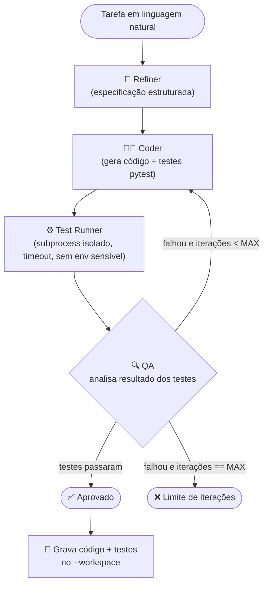

# devsquad-agents

> **EN summary:** A small multi-agent dev team (Refiner → Coder → QA) built with LangGraph that turns a natural-language task into tested Python code. Runs real pytest in an isolated subprocess, loops Coder↔QA until green, and works against any OpenAI-compatible LLM endpoint (Gemini free tier by default). Ships as a CLI and a FastAPI service, with eval benchmarks tracking success rate, iterations, tokens and latency.

---

## 1. O que é

Um "time de desenvolvimento" de agentes de IA: você descreve uma tarefa em português natural, e três agentes especializados (Refiner, Coder, QA) colaboram em loop até entregar código Python com testes reais passando.

```
$ devsquad run "funcao que valida CPF brasileiro com digitos verificadores"

Tarefa: funcao que valida CPF brasileiro com digitos verificadores

🧭 Refiner (iter 0): Implement a function that validates Brazilian CPF numbers,
correctly checking the verification digits.
👩‍💻 Coder (iter 1): Implemented the standard CPF check algorithm, handling
formatting, non‑string inputs, length checks, and the all‑equal‑digits rule.
🔍 QA (iter 1): aprovado

✅ Aprovado
Iterações: 1
Tokens totais: 3107
Latência: 11.2s
```

## 2. Por que existe

Fiz este projeto para o meu portfólio de IA Generativa. Mas ele não é só uma demo: é a ferramenta que eu uso para construir os próximos dois projetos do portfólio, apontando o `--workspace` para as pastas deles.

- `[em breve: link para o agente de pedidos de comida]`
- `[em breve: link para o RAG de avaliações de restaurantes]`

### Em uso real: gerando um módulo do food-order-agent

Exemplo real, rodado a partir do `devsquad-agents` apontando pro workspace do segundo projeto do portfólio:

```bash
devsquad run "modulo de carrinho de compras: uma classe Cart com os metodos add_item(item_id: str, nome: str, preco: float, quantidade: int) -> None (soma quantidade se o item_id ja existir), remove_item(item_id: str) -> bool (True se removeu, False se nao existia), list_items() -> list[dict] (cada item com item_id, nome, preco, quantidade, subtotal), subtotal() -> float (soma de todos os subtotais), e clear() -> None" \
  --workspace ../food-order-agent \
  --module src/foodagent/cart.py \
  --max-iterations 3
```

**O que passamos pra ele:** só a descrição da tarefa em linguagem natural, com a assinatura dos métodos esperados — nenhum código, nenhum exemplo de teste. O `--workspace`/`--module` dizem onde gravar se for aprovado.

**O que ele fez** (saída real do terminal):

```
🧭 Refiner (iter 0): Implementar um módulo de carrinho de compras com uma classe Cart que gerencia itens,
permitindo adicionar, remover, listar, calcular subtotal e limpar o carrinho.
👩‍💻 Coder (iter 1): Itens armazenados em dict interno preservando ordem de inserção. Validações rejeitam
bool como preço/quantidade por serem subclasses de int. Preço zero é aceito (não negativo).
🔍 QA (iter 1): aprovado

✅ Aprovado
Iterações: 1
```

O Coder decidiu por conta própria validar tipos de forma mais rígida do que o pedido original exigia — por exemplo, rejeitar `bool` como `preco`/`quantidade` (em Python, `isinstance(True, int)` é `True`, então sem essa checagem um `add_item("1", "x", True, 2)` passaria batido). E escreveu 11 casos de teste cobrindo carrinho vazio, acúmulo de quantidade no mesmo item, múltiplos itens, remoção existente/inexistente, limpar carrinho e as bordas de validação — tudo isso sem eu pedir caso a caso, só a partir da especificação de alto nível.

Arquivos gerados em `food-order-agent/src/foodagent/cart.py` e `test_cart.py` (link pro repositório assim que ele for publicado).

## 3. Arquitetura

### Visão geral

Grafo de estado (LangGraph) com três nós de agente e uma aresta condicional que decide entre repetir o ciclo de correção ou finalizar.



### Componentes

| Componente | Responsabilidade |
|---|---|
| **Refiner** | Recebe a tarefa bruta (+ arquivos de contexto opcionais do workspace) e produz uma especificação estruturada: objetivo, assinaturas de interface, critérios de aceite, casos de teste (incluindo bordas) e restrições. Saída validada com Pydantic. |
| **Coder** | Gera o módulo Python e os testes pytest a partir da spec. A partir da 2ª iteração, recebe também o diagnóstico do QA e corrige. |
| **Test Runner** | Executa o pytest gerado em diretório temporário isolado via `subprocess`, com timeout (30s padrão), sem herdar `LLM_API_KEY`/variáveis sensíveis, saída capturada e truncada. Não é um sandbox completo — ver seção 7. |
| **QA** | Interpreta a saída do Test Runner e produz um veredito estruturado (Pydantic): aprovado ou não, teste que falhou, traceback resumido, causa provável. |
| **LLM Client** | Cliente genérico compatível com OpenAI (`base_url` livre), com retry/backoff para 429/5xx, timeout, e parsing tolerante de JSON para respostas estruturadas quando o provedor não suporta `response_format`. Modelo configurável por agente. |
| **Orquestrador (LangGraph)** | Mantém o estado tipado do grafo (spec, código atual, histórico de tentativas, contagem de iterações, tokens) e a aresta condicional QA→Coder / QA→Fim. |

### Loop de autocorreção

```
Coder → Test Runner → QA
          ↑               │
          └── falhou ─────┘   (até MAX_ITERATIONS, padrão 3)
```

### Fluxo de dados (alto nível)

1. CLI/API recebe `task` (+ opcional `context`: arquivos existentes do workspace, `max_iterations`).
2. Refiner → `Spec` (Pydantic).
3. Coder(`Spec`, histórico QA) → `{codigo, testes}`.
4. Test Runner(`{codigo, testes}`) → `ResultadoExecucao` (stdout/stderr truncado, passou/falhou).
5. QA(`ResultadoExecucao`) → `Veredito` (aprovado | corrigir com diagnóstico).
6. Se aprovado ou limite atingido → grava no `--workspace` (ou não, se falhou e sem `--write-on-fail`) e retorna resultado final: código, testes, status, nº de iterações, histórico por agente, tokens.

## 4. Como rodar

```bash
# instalação local (uv)
uv sync --extra dev

# variáveis de ambiente
cp .env.example .env
# edite .env com seu provedor (veja abaixo)

# CLI
uv run devsquad run "função que valida CPF com dígitos verificadores"

# API (http://localhost:8000/docs)
uv run uvicorn devsquad.api:app --reload

# testes (não dependem de nenhuma API key, usam FakeLLM)
uv run pytest -q
```

### Configuração de provedor (qualquer endpoint compatível com OpenAI)

```env
LLM_BASE_URL=https://generativelanguage.googleapis.com/v1beta/openai/
LLM_API_KEY=...
LLM_MODEL=gemini-2.0-flash

# opcional: modelo diferente por agente
REFINER_MODEL=
CODER_MODEL=
QA_MODEL=
```

Exemplos de outros provedores oficiais compatíveis com OpenAI:

| Provedor | `LLM_BASE_URL` | Exemplo de `LLM_MODEL` |
|---|---|---|
| Gemini (padrão, free tier) | `https://generativelanguage.googleapis.com/v1beta/openai/` | `gemini-2.0-flash` |
| Groq (free tier) | `https://api.groq.com/openai/v1` | `openai/gpt-oss-120b` |
| OpenRouter (modelos `:free`) | `https://openrouter.ai/api/v1` | `meta-llama/llama-3.3-70b-instruct:free` |
| DeepSeek (API oficial) | `https://api.deepseek.com/v1` | `deepseek-chat` |
| Ollama (local) | `http://localhost:11434/v1` | `llama3.1` |

> Os nomes de modelo de provedores gratuitos mudam com frequência — confira a lista atual em `GET /v1/models` do provedor antes de rodar.

### Docker

```bash
docker compose up --build
# API disponível em http://localhost:8000/docs
```

O `Dockerfile` é multi-stage: builda as dependências com `uv` num estágio e copia só o `.venv` + `src/` para a imagem final.

## 5. CLI e API

### CLI

```bash
devsquad run "função que valida CPF com dígitos verificadores" \
  --workspace ../food-order-agent \
  --module src/validators/cpf.py \
  --max-iterations 3
```

Grava `src/validators/cpf.py` e `src/validators/test_cpf.py` no workspace informado, só se o QA aprovar (ou sempre, com `--write-on-fail`).

### API

- `POST /tasks` — `{ "task": "...", "max_iterations": 3 }` → resultado completo
- `GET /health`
- Swagger em `/docs`

```bash
curl -X POST http://localhost:8000/tasks \
  -H "Content-Type: application/json" \
  -d '{"task": "função que valida CPF com dígitos verificadores", "max_iterations": 3}'
```

```json
{
  "status": "approved",
  "code": "def validar_cpf(cpf: str) -> bool:\n    ...",
  "tests": "from solution import validar_cpf\n\n\ndef test_cpf_valido():\n    ...",
  "iterations": 1,
  "history": [
    {"agent": "refiner", "iteration": 0, "summary": "...", "prompt_tokens": 312, "completion_tokens": 180},
    {"agent": "coder", "iteration": 1, "summary": "...", "prompt_tokens": 540, "completion_tokens": 410},
    {"agent": "qa", "iteration": 1, "summary": "aprovado", "prompt_tokens": 120, "completion_tokens": 20}
  ],
  "total_tokens": 1582,
  "latency_seconds": 11.2,
  "written_to": null
}
```

## 6. Resultados das evals

`devsquad eval` roda as tarefas de `src/devsquad/evals.py` de ponta a ponta e grava a tabela em `evals/results.md`. Último run real (sem nenhuma edição manual):

**Resultados das evals (2026-11-04, modelo: `openai/gpt-oss-120b` via Groq)**

Taxa de sucesso: **100%** (6/6) · Média de iterações até passar: **1.3** · Média de tokens por tarefa: **5288** · Média de latência por tarefa: **30.8s**

| Tarefa | Status | Iterações | Tokens | Latência (s) |
|---|---|---|---|---|
| validar_cpf | ✅ | 2 | 6339 | 10.26 |
| parse_preco_brl | ✅ | 2 | 10700 | 72.78 |
| taxa_entrega | ✅ | 1 | 3146 | 23.46 |
| agrupar_pedidos_por_restaurante | ✅ | 1 | 4011 | 26.58 |
| paginar_lista | ✅ | 1 | 3676 | 24.17 |
| validar_email | ✅ | 1 | 3858 | 27.82 |

## 7. Decisões técnicas e trade-offs

- **Por que LangGraph:** estado tipado explícito e aresta condicional modelam naturalmente o loop Coder↔QA, sem precisar de uma máquina de estados escrita à mão.
- **Por que cliente compatível com OpenAI em vez de SDK nativo de cada provedor:** permite trocar de provedor só mudando `LLM_BASE_URL`/`LLM_MODEL`, sem reescrever código — inclusive para endpoints locais.
- **Por que executar os testes de verdade (e não só pedir pro QA "revisar" o código):** um LLM julgando código visualmente erra; rodar pytest de fato dá um veredito objetivo e verificável.
- **Limites do sandbox atual:** subprocess isolado com timeout e sem variáveis sensíveis reduz risco, mas não é isolamento completo de SO/filesystem/rede. Próximo passo natural é rodar em container descartável (`SANDBOX=docker`, se der tempo).

## 8. Próximos passos

- Sandbox real em container descartável.
- Mais agentes: `Architect` (decisões de design antes do Coder), `Docs` (gera docstrings/README do módulo).
- Cache de respostas do LLM entre iterações.
- UI simples para acompanhar o grafo em execução.
