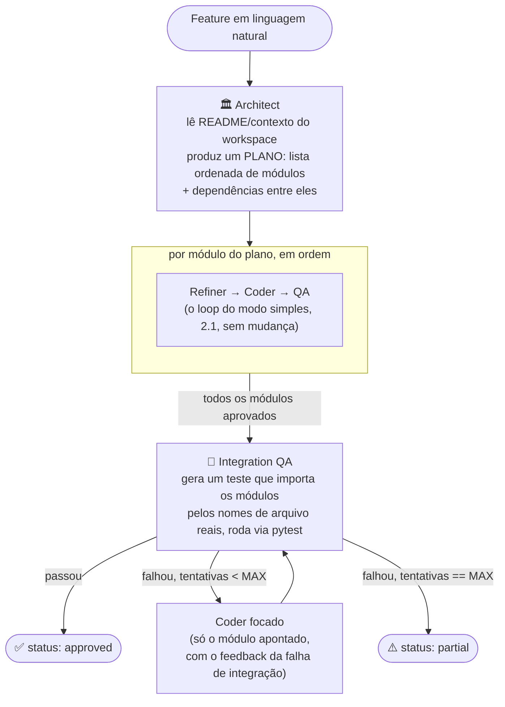

# devsquad-agents

## 1. O que é

Um "time de desenvolvimento" de agentes de IA: você descreve uma tarefa em português natural, e três agentes especializados (Refiner, Coder, QA) colaboram em loop até entregar código Python com testes reais passando. Cada iteração é validada rodando pytest de verdade num subprocess isolado — não um LLM "revisando" o próprio código — e o loop só termina quando os testes passam ou o limite de tentativas é atingido, então o resultado final sempre tem um status verificável, nunca uma suposição.

## 2. Arquitetura

O projeto tem dois modos, do mais simples ao mais completo, documentados em blocos separados abaixo. Os dois usam o mesmo motor por baixo (nenhum código duplicado): o modo completo (2.2) só adiciona duas camadas em volta do modo simples (2.1).

- **`devsquad run`** — um módulo por vez. Três agentes (Refiner, Coder, QA) em loop até o código passar nos testes de verdade.
- **`devsquad build-feature`** *(modo completo, dá pra construir uma funcionalidade inteira)* — um Architect planeja vários módulos, cada um passa pelo loop do modo simples sem nenhuma mudança, e um Integration QA testa os módulos juntos no final, corrigindo o módulo certo se algo não se encaixar.

---

### 2.1 Modo simples — `devsquad run`

**Visão geral**


**Loop de autocorreção**

```
Coder → Test Runner → QA
          ↑               │
          └── falhou ─────┘   (até MAX_ITERATIONS, padrão 3)
```

**Componentes**

| Componente | Responsabilidade |
|---|---|
| **Refiner** | Recebe a tarefa bruta (+ contexto) e produz uma especificação estruturada: objetivo, assinaturas de interface, critérios de aceite, casos de teste (incluindo bordas) e restrições. Saída validada com Pydantic. |
| **Coder** | Gera o módulo Python e os testes pytest a partir da spec. A partir da 2ª iteração, recebe também o diagnóstico do QA e corrige. |
| **Test Runner** | Executa o pytest gerado em diretório temporário isolado via `subprocess`, com timeout (30s padrão), sem herdar `LLM_API_KEY`/variáveis sensíveis, saída capturada e truncada. Não é um sandbox completo (isolamento de SO/filesystem/rede ainda não existe). |
| **QA** | Interpreta a saída do Test Runner e produz um veredito estruturado (Pydantic): aprovado ou não, teste que falhou, traceback resumido, causa provável. |
| **LLM Client** | Cliente genérico compatível com OpenAI (`base_url` livre), com retry/backoff para 429/5xx, timeout, e parsing tolerante de JSON para respostas estruturadas quando o provedor não suporta `response_format`. Modelo configurável por agente. |
| **Orquestrador (LangGraph)** | Mantém o estado tipado do grafo (spec, código atual, histórico de tentativas, contagem de iterações, tokens) e a aresta condicional QA→Coder / QA→Fim. |

**Fluxo de dados**

1. CLI/API recebe `task` (+ opcional `context`: arquivos existentes do workspace, `max_iterations`).
2. Refiner → `Spec` (Pydantic).
3. Coder(`Spec`, histórico QA) → `{codigo, testes}`.
4. Test Runner(`{codigo, testes}`) → `ResultadoExecucao` (stdout/stderr truncado, passou/falhou).
5. QA(`ResultadoExecucao`) → `Veredito` (aprovado | corrigir com diagnóstico).
6. Se aprovado ou limite atingido → grava no `--workspace` (ou não, se falhou e sem `--write-on-fail`) e retorna resultado final: código, testes, status, nº de iterações, histórico por agente, tokens.

---

### 2.2 Modo completo — `devsquad build-feature`

**Visão geral**



**Componentes**

| Componente | Responsabilidade |
|---|---|
| **Architect** | Recebe a feature + contexto do workspace (README + `--context-dir`) e produz um `Plan`: lista ordenada de módulos, cada um com sua tarefa e os contratos (assinaturas) que módulos anteriores do plano expõem. |
| **Module Loop** | Roda o loop do modo simples (2.1) uma vez por módulo do plano, na ordem de dependência. Cada módulo aprovado entra como contexto dos módulos seguintes. |
| **Integration QA** | Só roda depois que todos os módulos passaram individualmente. Gera um teste de integração que importa os módulos pelos nomes de arquivo reais e roda via `pytest` (mesmo Test Runner do modo simples, estendido pra múltiplos arquivos). Se falhar, aponta qual módulo é a causa raiz. |
| **Fix (Coder focado)** | Reaproveita direto o Coder do módulo apontado, com o feedback do Integration QA — sem rodar o Refiner de novo nem refazer os outros módulos. |

**Fluxo de dados**

1. Architect(`feature`, contexto) → `Plan` (lista de `PlannedModule`, cada um com `task` e `depends_on`).
2. Pra cada módulo do plano, nessa ordem: roda o fluxo do modo simples (2.1), usando o código dos módulos já aprovados como contexto do próximo.
3. Com todos os módulos aprovados: Integration QA gera um teste que importa os módulos de verdade e roda via Test Runner (multi-arquivo).
4. Se aprovado → `status: approved`. Se não, e ainda há orçamento (`--max-integration-iterations`): identifica o módulo culpado (`IntegrationVerdict.failing_module`), roda o Coder só nesse módulo com o feedback da falha, e repete o passo 3.
5. Se esgotar o orçamento sem aprovar → `status: partial`. Grava no `--workspace` todos os módulos gerados (aprovados ou não), e retorna o plano, cada módulo, o histórico completo e os tokens.

**Modelos de dados**

```python
class PlannedModule(BaseModel):
    module_path: str
    task: str
    depends_on: list[str] = []


class Plan(BaseModel):
    feature: str
    modules: list[PlannedModule]


class IntegrationVerdict(BaseModel):
    approved: bool
    failing_module: str | None = None
    traceback_summary: str | None = None
    feedback_for_coder: str | None = None


class FeatureResult(BaseModel):
    status: Literal["approved", "partial", "plan_failed"]
    plan: Plan
    modules: list[ModuleOutcome]
    history: list[AgentLogEntry]
    integration_attempts: int
    total_tokens: int
    latency_seconds: float
    written_to: list[str]
```

---

## 3. Como rodar

```bash
# instalação local (uv)
uv sync --extra dev

# variáveis de ambiente
cp .env.example .env
# edite .env com seu provedor (veja abaixo)

# CLI
uv run devsquad run "função que valida CPF com dígitos verificadores"

# API (http://localhost:8000/docs)
uv run uvicorn devsquad.api:app --reload

# testes (não dependem de nenhuma API key, usam FakeLLM)
uv run pytest -q
```

### Configuração de provedor (qualquer endpoint compatível com OpenAI)

```env
LLM_BASE_URL=https://generativelanguage.googleapis.com/v1beta/openai/
LLM_API_KEY=...
LLM_MODEL=gemini-2.0-flash

# opcional: modelo diferente por agente
REFINER_MODEL=
CODER_MODEL=
QA_MODEL=
```

Exemplos de outros provedores oficiais compatíveis com OpenAI:

| Provedor | `LLM_BASE_URL` | Exemplo de `LLM_MODEL` |
|---|---|---|
| Gemini (padrão, free tier) | `https://generativelanguage.googleapis.com/v1beta/openai/` | `gemini-2.0-flash` |
| Groq (free tier) | `https://api.groq.com/openai/v1` | `openai/gpt-oss-120b` |
| OpenRouter (modelos `:free`) | `https://openrouter.ai/api/v1` | `meta-llama/llama-3.3-70b-instruct:free` |
| DeepSeek (API oficial) | `https://api.deepseek.com/v1` | `deepseek-chat` |
| Ollama (local) | `http://localhost:11434/v1` | `llama3.1` |

> Os nomes de modelo de provedores gratuitos mudam com frequência — confira a lista atual em `GET /v1/models` do provedor antes de rodar.

### Docker

```bash
docker compose up --build
# API disponível em http://localhost:8000/docs
```

O `Dockerfile` é multi-stage: builda as dependências com `uv` num estágio e copia só o `.venv` + `src/` para a imagem final.

## 4. CLI e API

### `devsquad run`

```bash
devsquad run "<tarefa em linguagem natural>" [opções]
```

| Flag | Obrigatório? | Exemplo | O que faz |
|---|---|---|---|
| `<tarefa>` (argumento posicional) | **Sim** | `"funcao que valida CPF"` | Descrição da tarefa. Pode ser técnica (com assinatura) ou totalmente casual — o Refiner estrutura isso de qualquer forma; quanto mais vago, mais decisões de nome/formato ficam a critério do Refiner/Coder. |
| `--workspace` | Não | `--workspace ../outro-projeto` | Pasta do projeto onde gravar o resultado, se aprovado. Sem essa flag, o código só aparece na saída do terminal, não é gravado em disco. |
| `--module` | Só se usar `--workspace` | `--module src/cart.py` | Caminho (relativo ao `--workspace`) de onde gravar o módulo. Sem ele, mesmo com `--workspace`, nada é gravado. |
| `--max-iterations` | Não (padrão `3`) | `--max-iterations 5` | Quantas vezes o loop Coder↔QA tenta corrigir antes de desistir. |
| `--context` | Não | `--context ../outro-projeto/src/cart.py` | Um arquivo existente a dar como referência de estilo/convenção. Repita a flag pra vários arquivos. Por padrão, `devsquad run` **não sabe nada** do que já existe no workspace — isso é o único jeito manual de contar pra ele. |
| `--context-dir` | Não | `--context-dir ../outro-projeto/src` | Mesma ideia do `--context`, mas pega todos os `.py` de uma pasta de uma vez (ignora `test_*.py`). Repita pra várias pastas. |
| `--no-readme-context` | Não (desligado por padrão) | `--no-readme-context` | Por padrão, se `--workspace` é usado e existe um `README.md` na raiz dele, esse README **entra automaticamente como contexto** (é onde normalmente estão as convenções e decisões de domínio). Essa flag desliga esse comportamento. |
| `--write-on-fail` | Não | `--write-on-fail` | Grava no workspace mesmo se o QA **não** aprovar (por padrão, só grava quando aprovado). Útil pra inspecionar uma tentativa que não passou. |
| `--verbose` / `-v` | Não | `--verbose` | Mostra o output completo de cada agente — a `Spec` inteira do Refiner, o código+testes completos do Coder, o `Verdict` inteiro do QA — em vez de só o resumo de uma linha. |

**Exemplo mínimo** (só mostra o resultado no terminal, não grava nada):

```bash
devsquad run "função que valida CPF com dígitos verificadores"
```

**Exemplo completo**, gerando um módulo dentro de outro projeto e reaproveitando o estilo de um arquivo já existente:

```bash
devsquad run "cria uma funcao de busca no cardapio, recebendo a lista de itens e um texto digitado pelo usuario" \
  --workspace ../outro-projeto \
  --module src/catalog.py \
  --context-dir ../outro-projeto/src \
  --max-iterations 5
```

### `devsquad eval`

```bash
devsquad eval
```

Sem flags. Roda as tarefas fixas de `src/devsquad/evals.py` de ponta a ponta contra o provedor configurado no `.env`, imprime o resultado no terminal e grava a tabela em `evals/results.md` (ver seção 5).

### `devsquad build-feature`

```bash
devsquad build-feature "<feature em linguagem natural>" [opções]
```

Pra quando o pedido já é uma **funcionalidade** (vários módulos que se encaixam), não um módulo isolado — ver arquitetura completa na seção 2.

| Flag | Obrigatório? | Exemplo | O que faz |
|---|---|---|---|
| `<feature>` (argumento posicional) | **Sim** | `"carrinho de compras com busca no cardapio"` | Descrição da feature. O Architect quebra isso em um plano de módulos — você não escolhe os caminhos de arquivo aqui. |
| `--workspace` | Não | `--workspace ../outro-projeto` | Pasta do projeto onde gravar todos os módulos gerados (aprovados ou não — hoje `build-feature` não tem um `--write-on-fail`, sempre grava o que foi produzido). |
| `--max-module-iterations` | Não (padrão `3`) | `--max-module-iterations 5` | Mesmo que `--max-iterations` do `devsquad run`, mas aplicado a cada módulo do plano individualmente. |
| `--max-integration-iterations` | Não (padrão `2`) | `--max-integration-iterations 3` | Quantas vezes o Integration QA pode apontar um módulo pra corrigir antes de devolver `status: partial`. |
| `--context` / `--context-dir` / `--no-readme-context` | Não | iguais ao `devsquad run` | Mesmo mecanismo de contexto, aplicado ao Architect e a cada módulo do plano. |
| `--verbose` / `-v` | Não | `--verbose` | Mostra o `Plan` completo do Architect e o código+testes final de cada módulo, além do histórico resumido. |

**Exemplo:**

```bash
devsquad build-feature "carrinho de compras que busca itens no cardapio, adiciona ao carrinho e calcula o total com taxa de entrega" \
  --workspace ../outro-projeto \
  --context-dir ../outro-projeto/src
```

Saída inclui o plano do Architect, o histórico de cada módulo (Refiner/Coder/QA) e do Integration QA, e o status final: `approved` (tudo passou, inclusive integração), ou `partial` (módulos individuais passaram, mas a integração não fechou dentro do orçamento de tentativas).

### API

| Rota | Método | Corpo/parâmetros | Resposta |
|---|---|---|---|
| `/health` | `GET` | — | `{"status": "ok"}` |
| `/tasks` | `POST` | `{"task": "...", "max_iterations": 3}` (`max_iterations` opcional, padrão `3`) | `TaskResult` completo (abaixo) |
| `/docs` | `GET` | — | Swagger interativo |

> A API não tem `--workspace`/`--context` como a CLI — hoje ela só roda a tarefa e devolve o código, sem gravar em disco. Pra gerar dentro de um projeto real, use a CLI.

```bash
curl -X POST http://localhost:8000/tasks \
  -H "Content-Type: application/json" \
  -d '{"task": "função que valida CPF com dígitos verificadores", "max_iterations": 3}'
```

```json
{
  "status": "approved",
  "code": "def validar_cpf(cpf: str) -> bool:\n    ...",
  "tests": "from solution import validar_cpf\n\n\ndef test_cpf_valido():\n    ...",
  "iterations": 1,
  "history": [
    {"agent": "refiner", "iteration": 0, "summary": "...", "prompt_tokens": 312, "completion_tokens": 180},
    {"agent": "coder", "iteration": 1, "summary": "...", "prompt_tokens": 540, "completion_tokens": 410},
    {"agent": "qa", "iteration": 1, "summary": "aprovado", "prompt_tokens": 120, "completion_tokens": 20}
  ],
  "total_tokens": 1582,
  "latency_seconds": 11.2,
  "written_to": null
}
```

## 5. Resultados das evals

`devsquad eval` roda as tarefas de `src/devsquad/evals.py` de ponta a ponta e grava a tabela em `evals/results.md`. Último run real (sem nenhuma edição manual):

**Resultados das evals (2026-11-04, modelo: `openai/gpt-oss-120b` via Groq)**

Taxa de sucesso: **100%** (6/6) · Média de iterações até passar: **1.3** · Média de tokens por tarefa: **5288** · Média de latência por tarefa: **30.8s**

| Tarefa | Status | Iterações | Tokens | Latência (s) |
|---|---|---|---|---|
| validar_cpf | ✅ | 2 | 6339 | 10.26 |
| parse_preco_brl | ✅ | 2 | 10700 | 72.78 |
| taxa_entrega | ✅ | 1 | 3146 | 23.46 |
| agrupar_pedidos_por_restaurante | ✅ | 1 | 4011 | 26.58 |
| paginar_lista | ✅ | 1 | 3676 | 24.17 |
| validar_email | ✅ | 1 | 3858 | 27.82 |

## 6. Próximos passos

- Sandbox real em container descartável.
- Agente `Docs` (gera docstrings/README do módulo/feature).
- Cache de respostas do LLM entre iterações.
- UI simples para acompanhar o grafo em execução.
- `build-feature`: permitir que módulos gerados importem uns aos outros de verdade durante o teste unitário próprio (hoje cada módulo é testado isolado; só o Integration QA testa a composição real).
