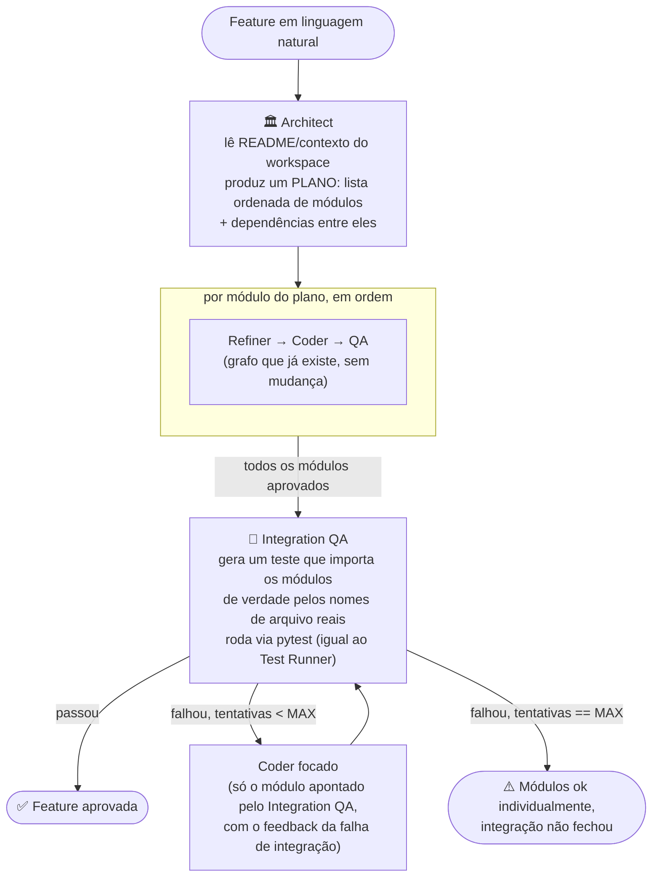

# v2: Architect + features multi-módulo

> ✅ Implementado (`devsquad build-feature`). Este documento continua sendo a referência de arquitetura; a seção "Riscos" no fim foi atualizada com o que apareceu de fato durante a implementação.

Objetivo: o `devsquad-agents` deixar de gerar só um módulo por vez e passar a construir uma **feature inteira** (vários arquivos que se encaixam), mantendo o grafo Refiner→Coder→QA que já existe como a peça interna.

## Por que assim

Baseado em dois padrões já validados na comunidade (ver referências no fim):

- **MetaGPT** separa papéis em sequência (Product Manager → **Architect** → Project Manager → Engineer → QA Engineer), onde o Architect transforma requisitos em um plano técnico antes de qualquer código ser escrito.
- **Plan-and-execute** (padrão comum em LangGraph): planeja todos os passos antes de executar qualquer um, em vez de decidir passo a passo — mais previsível pra um fluxo que, no fim, precisa gravar arquivos reais em disco.

A ideia central: **não jogar tudo fora**. O grafo Refiner→Coder→QA que já existe e está testado continua sendo a unidade de trabalho — só passa a rodar várias vezes, uma por módulo do plano, orquestrado por uma camada nova em volta dele.

## Visão geral



## Componentes novos

| Componente | Responsabilidade |
|---|---|
| **Architect** | Recebe a feature + contexto do workspace (README + `--context-dir`, mesmo mecanismo que já existe). Produz um `Plan`: lista ordenada de módulos, cada um com sua própria tarefa em linguagem natural e os **contratos** (assinaturas) que módulos anteriores do plano expõem — pra o Coder de um módulo saber o que já existe, sem precisar adivinhar. |
| **Module Loop** | Roda o grafo interno (Refiner→Coder→QA, inalterado) uma vez por módulo do plano, na ordem de dependência. Cada módulo aprovado entra automaticamente como contexto dos módulos seguintes (reaproveita o mesmo `context_files` que `--context`/`--context-dir` já alimentam). |
| **Integration QA** | Só roda depois que todos os módulos passaram individualmente. Gera um teste de integração pequeno que importa os módulos pelos nomes de arquivo reais (não um `solution.py` genérico) e roda via `pytest` — mesmo `Test Runner` isolado que já existe, estendido pra múltiplos arquivos. Se falhar, aponta **qual módulo** provavelmente precisa de ajuste. |
| **Fix (Coder focado)** | Em vez de rodar o Refiner de novo, reaproveita direto o Coder do módulo apontado, com o feedback do Integration QA — mesmo princípio do loop interno QA→Coder, só que disparado pela falha de integração em vez da falha de teste unitário. |

## Modelos novos (Pydantic)

```python
class PlannedModule(BaseModel):
    module_path: str
    task: str
    depends_on: list[str] = []  # module_path de outros módulos do plano


class Plan(BaseModel):
    feature: str
    modules: list[PlannedModule]


class ModuleOutcome(BaseModel):
    module_path: str
    result: TaskResult  # reaproveita o TaskResult que já existe


class IntegrationVerdict(BaseModel):
    approved: bool
    failing_module: str | None = None
    traceback_summary: str | None = None
    feedback_for_coder: str | None = None


class FeatureResult(BaseModel):
    status: Literal["approved", "partial", "plan_failed"]
    plan: Plan
    modules: list[ModuleOutcome]
    integration_attempts: int
    total_tokens: int
    latency_seconds: float
```

## CLI nova

```bash
devsquad build-feature "<feature em linguagem natural>" \
  --workspace ../food-order-agent \
  --max-module-iterations 3 \
  --max-integration-iterations 2
```

- `--max-module-iterations`: limite do loop Coder↔QA **dentro** de cada módulo (igual ao `--max-iterations` do `devsquad run` hoje).
- `--max-integration-iterations`: quantas vezes o Integration QA pode mandar corrigir um módulo específico antes de desistir e devolver `status: partial`.
- Sem `--module` — o Architect decide os caminhos de cada módulo do plano.

`devsquad run` continua existindo do jeito que está, pra quando você só quer um módulo isolado (mais rápido, mais previsível). `build-feature` é pra quando o pedido já é "uma funcionalidade", não "uma função".

## O que muda no `runner.py`

Hoje o `run_tests` só sabe escrever `solution.py` + `test_solution.py`. Pro Integration QA, precisa de uma variante que escreve **múltiplos arquivos com nomes reais**:

```python
def run_integration_tests(
    modules: dict[str, str],  # {"cart.py": "...", "catalog.py": "..."}
    integration_test: str,
    timeout_seconds: int = 30,
) -> ExecutionResult: ...
```

Mesmo princípio de isolamento (subprocess, timeout, env sanitizado) — só muda o que é escrito no diretório temporário antes de rodar o pytest.

## Riscos / limites conhecidos

- **Mais tokens e tempo por feature:** cada módulo ainda passa pelo loop Refiner→Coder→QA completo; uma feature de 4 módulos custa ~4x o que um `devsquad run` custa hoje, mais o Integration QA.
- **Architect pode planejar mal:** se ele dividir os módulos de um jeito estranho (acoplamento errado, dependência circular), o problema só aparece no Integration QA, não antes — é o trade-off de "planejar antes de executar".
- **Fix de integração é de 1 módulo por vez:** se o problema real envolve dois módulos ao mesmo tempo, pode levar mais de uma rodada de `--max-integration-iterations` pra convergir, ou nunca convergir (daí o `status: partial`).
- **QA de módulo não testa integração entre módulos ainda não escritos:** como cada módulo é gerado e testado isoladamente (sandbox só com `solution.py`/`test_solution.py`), o QA individual não detecta um bug que só se manifesta quando dois módulos interagem de verdade — exatamente o papel que o Integration QA cobre depois. Na prática isso apareceu nos testes: um módulo com lógica errada passou pelo QA individual, e só o Integration QA (rodando um teste real que importa os dois módulos juntos) encontrou o problema e mandou corrigir. É o comportamento esperado, não um bug — é a razão de o Integration QA existir.

## Referências usadas no desenho

- [MetaGPT paper (arXiv)](https://arxiv.org/pdf/2308.00352.pdf) — separação de papéis Product Manager → Architect → Project Manager → Engineer → QA Engineer.
- [What is MetaGPT? (IBM)](https://ibm.com/think/topics/metagpt)
- [ExecuGraph: multi-agent execution-grounded backend code synthesis](https://arxiv.org/pdf/2607.20499) — planner/gerador/revisor/avaliador orquestrados em grafo.
- [langgraph-app-builder](https://github.com/iamuv2000/langgraph-app-builder) — projeto experimental com planner → architect → loop coder → revisores → aggregator; inspirou o papel do Integration QA apontando o módulo culpado em vez de reprovar tudo.
